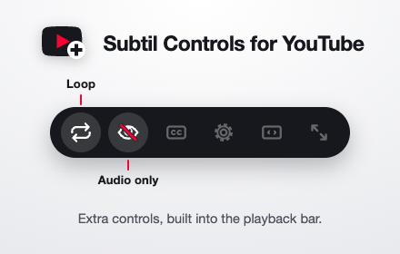
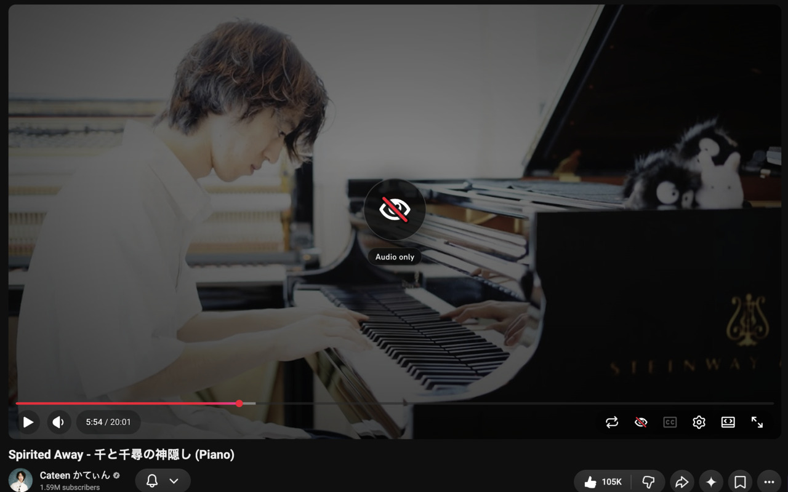
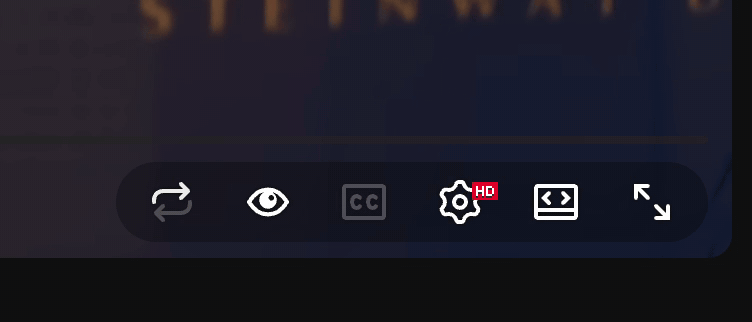
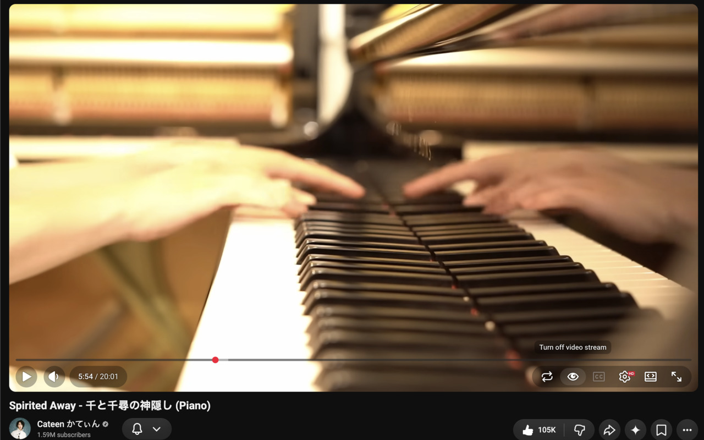
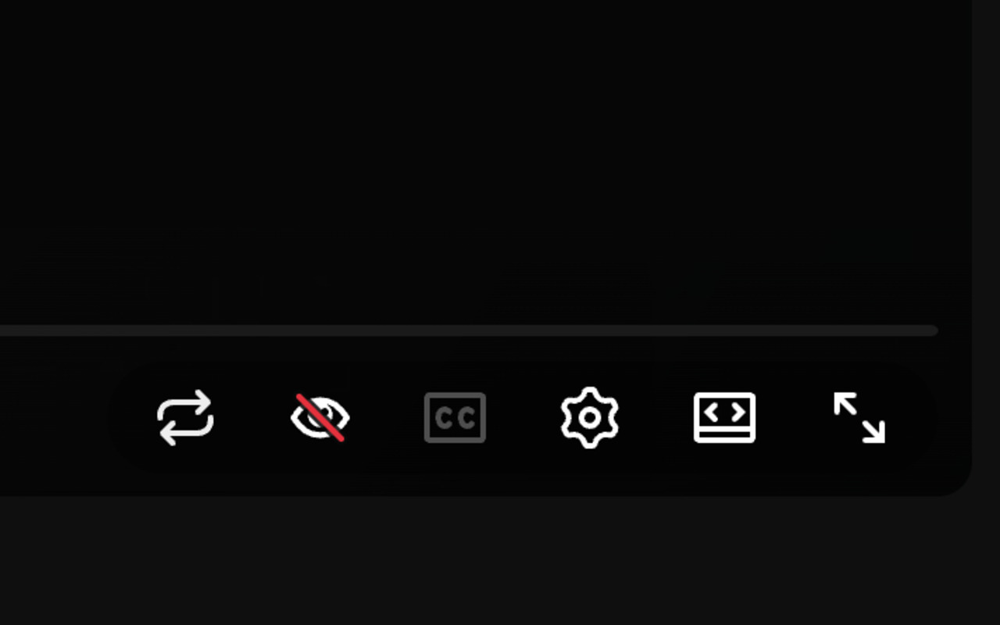

# &nbsp;Subtil Controls for YouTube

Chrome extension that adds an audio-only mode and a loop button directly to the YouTube playback bar.

The two buttons sit right before Settings and look like YouTube's own controls. There is no toolbar icon, no popup, and nothing to configure.

The interface is available in English, French, and Spanish, following the language selected in YouTube.

## Features

### Audio-only mode

Click the eye button to stop the video stream and keep listening. The player shows the video thumbnail and keeps the controls you know: play, seek, volume, speed, theater mode, and fullscreen. Click again to bring the video back at the same position.

This is not a hidden `<video>` element or a switch to 144p. The video pipeline is replaced by YouTube's own audio player, so nothing keeps downloading, decoding, or rendering video in the background.

### Loop

Click the loop button to replay the current video indefinitely. Looping follows the video into audio-only mode and resets when you open another video.

### Native look

Both buttons follow the size, weight, and tooltips of YouTube's own controls. The eye is struck through while audio-only mode is on, and the loop arrows close into a full loop while looping is on.

### Private by design

No permissions, no network rules, no analytics, no account. The extension only runs on `www.youtube.com`.

## Install

1. Download or clone this repository.
2. Open `chrome://extensions` in Chrome.
3. Enable **Developer mode**.
4. Click **Load unpacked** and select the repository folder.
5. Open or reload a YouTube video.

## Languages

The extension follows the interface language selected in YouTube, not the browser language. English, French, and Spanish are included. Any other language falls back to English.

To add a language:

1. Copy `src/locales/en.js` to `src/locales/<code>.js`, where `<code>` is the lowercase language code (`de`, `it`, or a regional variant such as `pt-br`).
2. Replace `.en` on the first line with your code (`['pt-br']` for a regional variant) and translate the values. Keep the keys unchanged.
3. Add the file to `content_scripts[0].js` in `manifest.json`, before `src/content.js`.
4. Run `npm run check`. It fails if a locale is missing from the manifest or its keys differ from `en.js`.

A regional variant is used when it matches YouTube's language exactly. Otherwise the base language applies (`es-419` uses `es`).

## How it works

- It creates a YouTube player whose media element is an `<audio>` element.
- It reuses the signed response for the current video without extracting or deciphering a private URL.
- It calls `stopVideo()` and then `clearVideo()` on the original player, closing its MediaSource and stopping the active video pipeline.
- It restores the playback position, speed, volume, and play/pause state when video playback is enabled again.

In audio-only mode, the active player contains only an `<audio>` element, while the original `<video>` reaches `readyState === 0`.

Chrome may temporarily retain previously received bytes in its HTTP cache or internal allocations. The practical guarantee is therefore **no active video download, decoding, or rendering after switching**, rather than "zero historical bytes in RAM."

## Compatibility and limitations

- Chrome 111 or later, on `youtube.com/watch` pages.
- Completed live replays are supported. Active and upcoming live streams, Shorts, and ads are not switched to audio-only mode.
- The Next button and autoplay are hidden in audio-only mode, so the media never changes without a matching page URL. YouTube links and recommendations work as usual.
- YouTube does not publicly document its audio-only player. An internal player change may require an extension update.

Behavior details

- Preview thumbnails fall back from high resolution to SD, HQ, MQ, and default sizes when a source is missing, invalid, or stalls.
- The playback and progress bars stay aligned when switching between classic, theater, and fullscreen modes.
- Clicking anywhere on the thumbnail toggles playback, including when YouTube's detached player ignores the native click.
- If YouTube rebuilds or temporarily removes its right-side control group, the extension reinserts its buttons and exposes a fallback restore button when necessary.

## Development

Requires Node.js 24 or later.

| Command | What it does |
| --- | --- |
| `npm run check` | Validates the manifest, scripts, icons, and locales, then runs the unit tests. |
| `npm run test:e2e` | Runs an end-to-end test in a real browser (after `npm install`). |
| `npm run package` | Runs the checks and creates `subtil-controls-for-youtube.zip`. |

Manual verification

1. Open DevTools and select the **Media** panel, or open `chrome://media-internals`.
2. Enable audio-only mode.
3. Confirm that `#ynv-audio-player` contains an `<audio>` element but no `<video>` element.
4. Confirm that `#movie_player video` is paused with a `readyState` of `0`.
5. Compare CPU, memory, and network usage in Chrome Task Manager.

## License

MIT © 2026 [Lucas Pantanella](https://github.com/naei)
